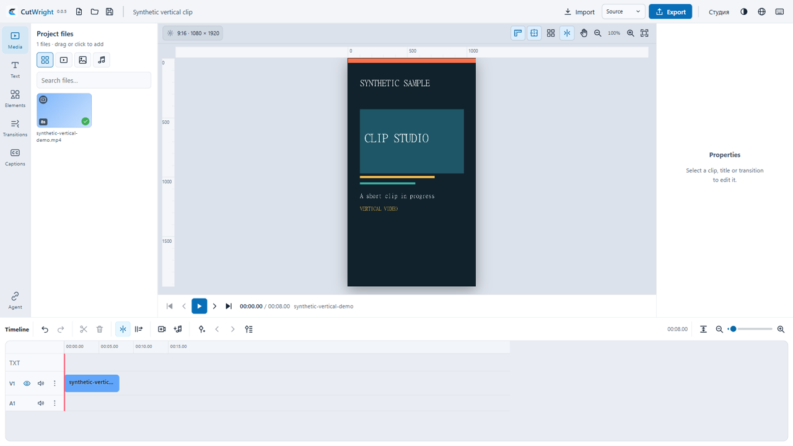

# Clip Studio

Clip Studio turns long videos into reviewable vertical clips. It combines a local FastAPI service for source analysis and clip rendering with a browser timeline based on [CutWright](https://github.com/iwatkot/cutwright). Video creators can import footage, make a clip by hand, and export it before setting up AI analysis.



> **Pre-release:** This is a source distribution for technical Windows users. There is no Clip Studio installer yet. Keep a copy of your original media and projects.

## Requirements

- Windows 10/11, Python 3.12, and a current desktop Chrome or Edge browser.
- FFmpeg and FFprobe on `PATH`, or both executables in the local `clip/tools/ffmpeg/ffmpeg-9.0.1-essentials_build/bin/` directory used by the launcher.
- Enough disk space for source videos, intermediate renders, and exports.
- Node.js 24 and npm only if you want to rebuild the bundled editor.

The base Python installation uses CPU processing. NVIDIA CUDA dependencies for GPU processing are optional and can be installed later with `clip/requirements-gpu.txt`.

## Make your first clip manually

1. Clone this repository and open PowerShell in its root directory.
2. Install the Python dependencies:

   ```powershell
   py -3.12 -m venv clip/.venv
   .\clip\.venv\Scripts\python.exe -m pip install -r clip/requirements.txt
   ```

3. Run `Open Studio.bat`. It starts the local service and opens `/studio/` in your browser. If the browser does not open, visit `http://127.0.0.1:8081/studio/` (the launcher may choose another free port).
4. Use the globe in the editor toolbar to select English if needed. Click **Import**, select a local video, and add it to the timeline. Trim the section you want, set a vertical project size, and click **Export**. Keep the browser tab open until export finishes.

The launcher creates `clip/gaming-run.db` and `clip/gaming-run-storage/` locally. These files are ignored by Git and should be backed up separately. The browser editor can save a CutWright project for later editing; preserve its source media as well.

## Try automatic selection

AI storyboard analysis is optional and **requires a compatible external OpenAI-style vision API and your own API key**. The automatic workflow is not fully offline. It also needs Redis and a Celery worker; `Open Studio.bat` alone does not start those services.

For this workflow, use the [Docker Compose stack](clip/docker-compose.yml) described in the [Clip Service documentation](clip/README.md). Copy `clip/.env.example` to `clip/.env`, set `CLIP_STORAGE_ROOT=./storage` for the host volume, replace the example `CLIP_API_KEY`, and add your own `CLIP_PERLAPENNA_BASE_URL` and `CLIP_PERLAPENNA_API_KEY`. Run `docker compose up --build` from `clip/`. Submit a YouTube source, or a local file mounted under `/data/clips`, with `POST /sources`; then create a job with `POST /jobs` using its `source_id` and no `intervals`. Poll `GET /jobs/{id}` and review the resulting clips through the service endpoints. The API requires the `X-API-Key` header set to your `CLIP_API_KEY`. Without vision API settings, an automatic job reports `needs_configuration`; manual timeline editing still works.

See [Clip Service documentation](clip/README.md) for the API, rendering options, and optional local voiceover. Voiceover has separate Ollama and Piper model requirements.

## Rebuild the bundled editor

The source of the modified CutWright editor is in `studio-editor/`. With Node.js 24 installed:

```powershell
Set-Location studio-editor
npm ci
Set-Location ..
.\studio-editor\scripts\build-studio.ps1
```

This updates `clip/clip_service/studio_web/` and includes CutWright's license and third-party notices. To contribute, read [CONTRIBUTING.md](CONTRIBUTING.md). Report setup failures with the [bug report template](.github/ISSUE_TEMPLATE/bug_report.md).

## License and credits

Clip Studio's original code is licensed under [AGPL-3.0-only](LICENSE). The modified CutWright editor retains its [separate AGPL-3.0-only license and copyright notices](studio-editor/LICENSE). Third-party dependencies and bundled assets retain their respective licenses in `clip/clip_service/studio_web/third-party/`.
